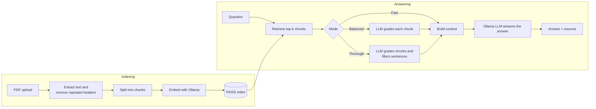

# 📚 RAG based Q&A with Ollama

Chat with your PDFs using an open-source LLM that you host yourself. Upload documents, ask questions in plain language, and get streamed answers grounded in your files, with the source file, page and excerpt shown for every answer. No data leaves your own infrastructure and no paid API key is needed.

Built with **Streamlit**, **Ollama**, **FAISS** and **LangGraph**. Runs locally, on **Render**, or on **Streamlit Community Cloud** (with a remote Ollama server).

<!-- Add a screenshot or GIF of the app here:

-->

## Features

- **Chat interface** with streaming answers and conversation history
- **Source citations**: every answer lists the file, page number, relevance score and excerpt it used
- **Fully self-hosted**: chat and embedding models both run on Ollama
- **Three answer modes**: Fast, Balanced and Thorough, to trade speed for precision
- **Built-in Ollama manager**: test the connection and download missing models from the sidebar
- **Retrieval clean-up**: repeated page headers and footers are removed before indexing, and embedding prefixes are applied automatically for `nomic-embed-text`
- **One-click Render deployment** through a Blueprint (`render.yaml`)
- **Lightweight**: no PyTorch or sentence-transformers, so installs and deploys stay small

## How it works



The retrieve → grade → refine steps run as a [LangGraph](https://github.com/langchain-ai/langgraph) workflow. The final answer is streamed from the LLM so text appears as it is generated.

### Answer modes

| Mode | What it does | Best for |
| --- | --- | --- |
| **Fast** (default) | Retrieve chunks, then answer | CPU-only servers, small models |
| **Balanced** | Also asks the LLM to score each chunk's relevance and drops weak ones | Better precision when the model is reliable |
| **Thorough** | Also filters the context sentence by sentence | Highest precision, slowest (many extra model calls) |

If grading finds nothing relevant, the app says the documents don't contain enough information instead of letting the model guess.

## Tech stack

| Part | Technology |
| --- | --- |
| UI | Streamlit |
| LLM and embeddings | Ollama (default `gemma3:1b` and `nomic-embed-text`) |
| Vector store | FAISS (in memory) |
| Orchestration | LangChain and LangGraph |
| PDF parsing | pypdf |

## Project structure

```
.
├── app.py               # Streamlit chat UI
├── rag_core.py          # Indexing, LangGraph pipeline, Ollama helpers (no Streamlit code)
├── requirements.txt     # Python dependencies
├── render.yaml          # Render Blueprint (Ollama service + web app)
├── Dockerfile.ollama    # Ollama server image for Render
├── ollama-start.sh      # Starts Ollama and pulls the models on first boot
└── .env.example         # Local settings template
```

## Quick start (local)

**Prerequisites:** Python 3.10+ and [Ollama](https://ollama.com) version 0.5 or newer (needed for structured output).

```bash
# 1. Pull the models
ollama pull gemma3:1b
ollama pull nomic-embed-text

# 2. Install dependencies
python -m venv .venv
source .venv/bin/activate        # Windows: .venv\Scripts\activate
pip install -r requirements.txt

# 3. (Optional) copy the settings template
cp .env.example .env

# 4. Run
streamlit run app.py
```

## Configuration

Settings are read from environment variables, then Streamlit secrets, then the defaults below. Each can also be changed in the app sidebar.

| Variable | Default | Description |
| --- | --- | --- |
| `OLLAMA_BASE_URL` | `http://127.0.0.1:11434` | Ollama server URL (`host:port` also works) |
| `OLLAMA_MODEL` | `gemma3:1b` | Chat model |
| `OLLAMA_EMBED_MODEL` | `nomic-embed-text` | Embedding model |
| `OLLAMA_API_KEY` | *(empty)* | Optional Bearer token for an authenticated proxy |

Under **Advanced** in the sidebar you can also change the number of retrieved chunks (default 4), the chunk size, and the relevance thresholds used by Balanced and Thorough modes.

## Troubleshooting

| Problem | What to do |
| --- | --- |
| `WinError 10061` or "connection refused" | Ollama is not running at that URL. Start it, then click **Test connection**. |
| "Not installed yet" in the sidebar | Click **Download missing models**. |
| "Couldn't find enough information" | Open **Sources & details** to see which pages were retrieved. If they are the wrong pages, rebuild the index, ask with full terms ("generative AI" rather than "gen ai") and raise **Chunks to retrieve**. If the pages are right but rejected, use **Fast** mode or lower **Keep chunks scoring above**. |
| No text extracted | The PDF is probably scanned images and needs OCR first. |
| Search results got worse after changing models | Changing the embedding model requires rebuilding the index. |
| Slow answers | Use **Fast** mode, retrieve fewer chunks, or use a stronger server or GPU. |

## Limitations

- The index is stored in memory and is lost on restart.
- Each question is answered on its own, so follow-ups like "explain more" don't see earlier answers.
- Scanned PDFs without a text layer are not supported.
- Answer quality depends on the model you choose. Very small models can miss details or grade relevance unreliably.
